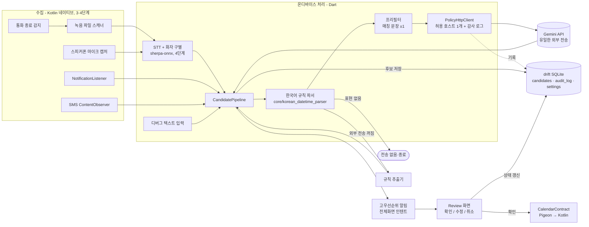

# Call to To-do 아키텍처

통화 녹음과 메신저 알림에서 일정을 찾아, 사용자 확인을 거쳐 기기 캘린더(구글 계정 동기화)에 등록하는 Android 우선 Flutter 앱이다. 이 문서는 승인된 계획을 구현 수준으로 상세화한 설계 문서이며, 코드가 바뀌면 함께 갱신한다.

## 1. 확정된 결정

| 주제 | 결정 | 이유 |
| --- | --- | --- |
| 음성 인식·화자 구별 | **온디바이스** (sherpa-onnx) | 통화 오디오는 가장 민감한 데이터. 기기 밖으로 내보내지 않는다. |
| 일정 추출 | 로컬 규칙 파서 1차 → 일정 표현 주변 문장만 **Gemini API** 전송 | 전체 대화가 아니라 필요한 조각만 보낸다. 규칙 파서만으로도 동작해야 한다. |
| 외부 전송 | Gemini 단일 호스트 외 **전면 금지**. 분석·크래시 SDK 없음 | 코드 수준에서 강제(단일 HTTP 클라이언트 + 감사 로그). |
| 통화 인식 경로 | 통화 종료 직후 **녹음 파일 감지**가 주 경로. 실시간은 스피커폰 마이크 캡처로 제한 | Android 는 통화 오디오 직접 접근을 막는다. |
| 캘린더 등록 | Android **CalendarContract** | 기기 캘린더에 쓰면 구글 계정이 동기화한다. OAuth·REST 불필요. |
| 메신저 수집 | **NotificationListenerService** 로 알림 텍스트만 | 카카오톡·A. 전화 등은 공개 API 가 없다. |
| iOS | 후순위 축소판 (공유 시트/수동 입력 → EventKit) | 통화 녹음·알림 수신·SMS 접근이 OS 차원에서 불가. |

## 2. 전체 구조



### 데이터 흐름 (코어 파이프라인, 이 PR 범위)

1. 텍스트가 `CandidatePipeline.run(text, sourceApp)` 으로 들어온다. 지금은 디버그 "텍스트 입력" 화면이 유일한 소스이고, 3·4단계 수집기는 같은 함수를 호출하면 된다.
2. `KoreanDateTimeParser` 가 날짜·시각·반복 표현을 찾는다. **하나도 없으면 여기서 끝**이고 네트워크는 쓰지 않는다.
3. 설정의 "외부 전송 끄기" 가 켜져 있거나 Gemini 키가 없으면 `RuleExtractor` 가 규칙 파서 결과만으로 후보를 만든다.
4. 그렇지 않으면 `Prefilter` 가 매칭 문장과 앞뒤 1문장만 골라 `GeminiExtractor` 로 보낸다. 요청은 반드시 `PolicyHttpClient` 를 거친다.
5. Gemini 가 JSON 스키마대로 돌려준 배열을 `ScheduleCandidate` 로 바꾼다. 실패·빈 응답·정책 차단 시 규칙 추출기로 폴백한다.
6. 후보를 drift `candidates` 에 `pending` 으로 저장하고 후보마다 고우선순위 알림을 띄운다.
7. 알림을 탭하면 `ReviewPage` 가 열린다. **확인** → 선택한 캘린더에 `CalendarContract` 로 삽입하고 `confirmed`; **수정** → 필드 편집 후 확인; **취소** → `cancelled`.

## 3. 기술 스택 (선택한 버전)

| 영역 | 패키지 / 도구 | 버전 | 비고 |
| --- | --- | --- | --- |
| 프레임워크 | Flutter stable / Dart | 3.47.9 / 3.13.7 | Android minSdk 26, targetSdk 35, compileSdk 는 Flutter 요구값(36) |
| 네이티브 | Kotlin, AGP | 2.4.0, 9.1.0 | `kotlinx-coroutines-android` 1.10.2 (Pigeon `@async` 가 `suspend` 로 생성됨) |
| 채널 | `pigeon` | 29.1.0 | Dart↔Kotlin 은 모두 Pigeon. 수동 MethodChannel 금지 |
| 상태 | `flutter_riverpod` + `riverpod_annotation`/`riverpod_generator` | 3.4.3 / 4.0.7 / 4.0.9 | 모든 의존성은 `lib/app/providers.dart` 에서 조립 |
| 라우팅 | `go_router` | 18.1.2 | `/`, `/debug/text`, `/settings`, `/review/:id` |
| 모델 | `freezed` + `json_serializable` | 4.0.3 / 6.15.2 | `ScheduleCandidate` |
| 로컬 DB | `drift` + `drift_flutter` | 2.35.3 / 0.3.1 | `candidates`, `audit_log`, `settings` |
| 비밀 저장 | `flutter_secure_storage` | 11.2.0 | Gemini API 키만 |
| HTTP | `http` | 1.6.0 | `PolicyHttpClient` 가 유일한 `http.Client` |
| LLM | `google_generative_ai` | 0.4.7 | Flash 모델(기본 `gemini-2.5-flash`, 설정에서 변경), JSON 스키마 응답, `httpClient` 주입 |
| 알림 | `flutter_local_notifications` | 22.3.3 | `Importance.max` + `fullScreenIntent` |
| 테스트 | `flutter_test`, `mocktail`, `http/testing.dart` | - | Gemini 경로는 `MockClient` 로 end-to-end |
| CI | GitHub Actions | - | analyze(`--fatal-infos`) · test · 생성 코드 최신 여부 · debug APK |

> `google_generative_ai` 는 Google 이 `firebase_ai` 로의 전환을 권하고 있지만, Firebase 의존(= 추가 외부 전송 경로)을 피하기 위해 계획대로 직접 REST 패키지를 쓴다. 패키지가 더 이상 동작하지 않게 되면 `GeminiExtractor` 내부만 교체하면 된다(`PolicyHttpClient` 주입 구조 유지).

## 4. 저장소 구조

```
docs/ARCHITECTURE.md                 # 본 문서
pigeons/calendar_api.dart            # Pigeon 정의 (dart run pigeon --input …)
lib/
  main.dart                          # 설정 로드 → 알림 초기화 → 라우터
  app/                               # app(테마·로캘), router, providers(DI), home_page
  core/
    korean_datetime_parser/          # 규칙 파서 (순수 Dart, 네트워크 없음)
    privacy/                         # NetworkPolicy, PolicyHttpClient, AuditSink
    pigeon/calendar_api.g.dart       # 생성 코드
  data/                              # drift 테이블·DB, 행↔모델 매퍼
  features/
    capture/        (3단계 자리)      # NotificationListener·SMS·통화 종료 어댑터
    transcription/  (4단계 자리)      # sherpa-onnx STT·화자 구별·모델 관리
    extraction/                      # ScheduleCandidate, Prefilter, RuleExtractor,
                                     # GeminiExtractor, ExtractionService, CandidatePipeline
    review/                          # ReviewPage, RecurrenceField, ReviewNotifications
    calendar/                        # CalendarRepository (Pigeon 래퍼, RRULE/종일 변환)
    settings/                        # SettingsRepository, SettingsPage
    debug/                           # 텍스트 입력 화면
android/app/src/main/kotlin/com/calltotodo/call_to_todo/
  MainActivity.kt                    # Pigeon setUp, 권한 콜백 위임
  CalendarHostApiImpl.kt             # CalendarContract 조회/삽입, 런타임 권한
  CalendarApi.g.kt                   # 생성 코드
test/core, test/features             # 파서·정책·프리필터·직렬화·추출 서비스
.github/workflows/ci.yml
```

생성 코드(`*.g.dart`, `*.freezed.dart`, Pigeon 출력)는 커밋한다. CI 가 `build_runner` 와 `pigeon` 을 다시 돌려 차이가 없는지 검사한다.

## 5. 핵심 컴포넌트

### 5.1 한국어 규칙 파서 (`core/korean_datetime_parser`)

- 입력 텍스트 전체를 정규식 테이블로 스캔해 날짜·시각·반복·횟수·기간 토큰을 만들고, 겹치면 긴 토큰을 남긴다("11월 5일" 이 "5일" 을 이김).
- 문장 경계(`. ! ? 줄바꿈`)가 없고 16자 이내로 이어진 토큰을 한 일정으로 묶는다. 날짜가 두 번 나오면 분리하고, "월요일, 수요일" 같은 요일 나열은 허용한다.
- 지원 표현: 오늘/내일/모레/글피, 이번·다음·다다음 주 X요일, X요일, 주말, N월 N일, YYYY년 N월 N일, N/N, N일, 다음 달 N일, N일 뒤, N주 후, 오전·오후·아침·저녁·밤·새벽·낮 N시 N분/반, 고유어 수사(한~열두 시), HH:MM, 정오/자정, 시각 범위(부터·까지·~·에서), 매일/매주/격주/매월/매년, 매주 월수금·화·목요일, N주마다, N일마다, N개월마다, 주 N회, N회(COUNT), N주간·N개월간(COUNT/UNTIL).
- 해석 규칙: 오전/오후 없는 1~6시는 오후, 7~11시는 오전(같은 문장의 저녁/아침 단서가 우선). 날짜 없이 시각만 있고 이미 지났으면 내일. 요일 반복(BYDAY)은 가장 가까운 해당 요일부터 시작. "다음 주 화요일" 처럼 주가 명시된 요일은 BYDAY 로 흡수하지 않고 구체 날짜로 취급.
- 출력 `ParsedSchedule { start, end?, hasDate, hasTime, rrule?, matchedText, startOffset, endOffset }`. 오프셋은 프리필터와 제목 추정에 쓰인다.

### 5.2 프라이버시 레이어 (`core/privacy`)

- `NetworkPolicy`: 허용 호스트 `generativelanguage.googleapis.com` 하나, https 필수. 판정 결과에 차단 사유 코드(`host_not_allowed`, `insecure_scheme`, `external_transfer_disabled`).
- `PolicyHttpClient extends http.BaseClient`: 앱의 **유일한** HTTP 클라이언트. 모든 `send()` 가 정책을 거치고, 허용/차단과 무관하게 `AuditSink` 에 **시각·호스트·메서드·허용 여부·사유·요청 바이트 수** 를 남긴다. 본문은 어떤 형태로도 기록하지 않는다(테이블에 컬럼 자체가 없음).
- "외부 전송 끄기" 토글은 두 겹으로 작동한다. ① `ExtractionService` 가 Gemini 를 아예 만들지 않음, ② 혹시 다른 경로로 요청이 들어와도 `PolicyHttpClient` 가 `external_transfer_disabled` 로 차단.
- 새 네트워크 호출이 필요해지면 반드시 `policyHttpClientProvider` 를 주입받아야 하며, 다른 `http.Client()`/`HttpClient()` 생성은 코드 리뷰에서 거부한다.

### 5.3 추출 (`features/extraction`)

- `ScheduleCandidate { id, title, start, end, allDay, recurrence(RRULE), details, sourceText, sourceApp, extractor }` — freezed/json.
- `Prefilter`: 매칭 문장 ±1 문장만 선택, 인접 조각은 합치고 조각당 600자 제한. 일정 표현이 없으면 빈 결과.
- `GeminiExtractor`: 시스템 프롬프트에 출력 규칙, 사용자 프롬프트에 현재 시각·타임존·규칙 파서 힌트·조각. 응답은 JSON 스키마(배열, `title/start/end/all_day/recurrence/details`)로 강제. 파싱 시 형식이 틀린 항목은 건너뛰고 종료 시각을 보정한다.
- `ExtractionService`: 위 흐름을 조합하고 모든 실패를 규칙 추출기로 폴백한다. 결과에 어떤 추출기를 썼는지와 외부로 보낸 글자 수를 담아 디버그 화면에 표시한다.

### 5.4 Review 와 알림 (`features/review`)

- `ReviewNotifications`: 채널 `schedule_review`, `Importance.max`, `fullScreenIntent`, payload = 후보 ID. 앱이 알림으로 시작되면 `main()` 이 초기 라우트를 `/review/:id` 로 잡는다. Android 13+ 알림 권한, 14+ 전체화면 인텐트 권한을 첫 화면에서 요청한다.
- `ReviewPage`: 읽기 전용 → **수정** 으로 편집(이름·날짜·종일·시작/종료 시간·반복·세부내용). 반복은 프리셋(매일/매주/매월/매년)과 RRULE 직접 입력. 캘린더 드롭다운은 기본 캘린더를 자동 선택. **확인** 은 캘린더 삽입 → `confirmed` → 알림 제거.

### 5.5 캘린더 (`features/calendar` + Kotlin)

- Pigeon `CalendarHostApi`: `hasCalendarPermission`, `requestCalendarPermission`(@async), `listWritableCalendars`, `insertEvent`.
- Kotlin 구현은 `CALENDAR_ACCESS_LEVEL >= CONTRIBUTOR` 이고 `VISIBLE` 인 캘린더만 나열한다. 반복 이벤트는 CalendarContract 규칙대로 `DTEND` 대신 `DURATION`(`PT…S`/`P…D`) 을 쓰고, 종일 이벤트는 UTC 자정 + `EVENT_TIMEZONE=UTC` 로 저장한다. 타임존은 네이티브 기본값을 쓴다(Dart 와 같은 기기).
- 런타임 권한은 `ActivityCompat.requestPermissions` 와 `MainActivity.onRequestPermissionsResult` 로 처리하고 코루틴으로 Dart 에 결과를 돌려준다.

## 6. 프라이버시·네트워크 정책 요약

- 외부로 나가는 것: Gemini 요청(프리필터 조각 + 프롬프트)뿐. 음성·녹음 파일·알림 원문 전체·연락처는 나가지 않는다.
- 기록되는 것: 모든 네트워크 시도의 메타데이터(`audit_log`), 후보와 그 원문(`candidates`, 기기 내부).
- 기록되지 않는 것: 요청/응답 본문, API 키(안전 저장소에만).
- 꺼진 것: 분석·크래시 리포팅·광고 SDK. `pubspec.yaml` 에 해당 의존성이 없다.
- 사용자 제어: "외부 전송 끄기" 토글, API 키 삭제(빈 값 저장), 설정 화면의 감사 로그 열람.

## 7. 개발 단계

| 단계 | 내용 | 상태 |
| --- | --- | --- |
| 1 | 스캐폴드, 본 문서, CI, 네트워크 정책 레이어 | **이 PR** |
| 2 | 코어 파이프라인: 텍스트 입력 → 규칙 파서 → (프리필터 → Gemini) → Review → CalendarContract | **이 PR** |
| 3 | 메신저 수집: NotificationListener(카카오톡·구글 메시지·A. 전화), SMS 옵저버, Foreground Service, 허용 앱 설정 | 다음 |
| 4 | 통화 녹음: `TelephonyCallback` 통화 종료 감지 → `MediaStore`/`FileObserver` 녹음 스캔 → sherpa-onnx STT(SenseVoice-small 또는 Zipformer Korean) + silero VAD + 화자 구별(pyannote segmentation-3.0 + 3D-Speaker) → `CandidatePipeline.run` | 다음 |
| 5 | 스피커폰 실시간 모드(스트리밍 STT) | 후순위 |
| 6 | iOS 축소판(EventKit, 공유 시트) | 후순위 |

3·4단계는 `lib/features/capture/`, `lib/features/transcription/` 에 들어가며, 결과 텍스트를 `CandidatePipeline.run(text, sourceApp: 'kakao' | 'sms' | 'call')` 으로 넘기면 나머지는 그대로 동작한다.

## 8. 테스트와 CI

- 단위 테스트: 규칙 파서(36), 네트워크 정책·감사 로그(9), 프리필터(5), 후보 직렬화·drift 매핑·CalendarContract 변환(5), 추출 서비스·Gemini 파싱(9). Gemini 경로는 `http/testing.dart` 의 `MockClient` 를 `PolicyHttpClient` 안쪽에 넣어 실제 요청 본문과 감사 로그까지 검증한다.
- CI(`.github/workflows/ci.yml`): `flutter pub get` → `build_runner`/`pigeon` 재생성 후 `git diff --exit-code` → `flutter analyze --fatal-infos` → `flutter test` → `flutter build apk --debug` 와 아티팩트 업로드.

## 9. 알려진 위험

- `READ_SMS` 와 NotificationListener 는 Play 스토어 심사에서 제한되는 권한이다. 개인 배포(사이드로드)를 전제로 하며, 스토어 배포 시 SMS 는 제외해야 할 수 있다.
- A. 전화의 녹음 저장 경로는 기기마다 달라 설정에서 사용자가 지정하도록 한다(4단계).
- 온디바이스 한국어 STT 정확도는 클라우드보다 낮다. Review 확인 단계가 이를 보완한다.
- 규칙 파서의 오전/오후 추정("3시" → 15시)은 휴리스틱이다. Gemini 가 켜져 있으면 문맥으로 보정되고, 꺼져 있으면 사용자가 Review 에서 고친다.
- `google_generative_ai` 패키지 유지보수 종료 가능성(3절 참고).
- 전체화면 인텐트 권한(Android 14+)은 사용자가 거부할 수 있다. 그 경우 헤드업 알림으로만 동작한다.
